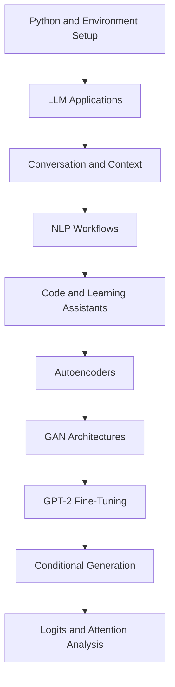

# GENERATIVE AI WITH DEEP LEARNING & LARGE LANGUAGE MODELS

### A hands-on learning repository for LLM applications, deep generative models, and GPT-2 experimentation

<p align="center">
  
</p>

## ✨ Overview

**Generative AI with Deep Learning & LLMs** is a Python learning
repository covering practical language-model applications, deep
generative architectures, and GPT-2 experimentation.

The documented learning material is organized into three major areas:

1.  **LLM applications and NLP** --- chatbot workflows, conversation
    context, summarization, translation, sentiment analysis, grammar
    correction, code generation, quiz generation, and topic explanation.
2.  **Deep generative models** --- autoencoders, variational
    autoencoders, DCGAN, Progressive GAN, and Wasserstein GAN concepts.
3.  **GPT fine-tuning and analysis** --- custom-corpus fine-tuning,
    conditional generation, sampling strategies, logits, perplexity, and
    attention inspection.

The goal is to connect conceptual understanding with practical Python
and PyTorch implementations.

### At a glance

  Area               Documented focus
  ------------------ ------------------------------------------------
  Language models    API-based chatbot and text workflows
  NLP                Summarization, translation, sentiment, grammar
  Developer tools    Code generation and refactoring concepts
  Learning tools     Quiz generation and topic explanation
  Computer vision    Autoencoders and GAN architectures
  Model adaptation   GPT-2 fine-tuning on custom text
  Model analysis     Sampling, logits, perplexity, attention

### What this repository is

-   A practical learning and experimentation codebase.
-   A collection of topic-focused Python modules.
-   A starting point for understanding generative AI workflows.
-   A place to compare different model families and techniques.

### What this repository does not claim

-   It does not claim that every script is production-ready.
-   It does not guarantee model quality or factual correctness.
-   It does not guarantee that every module runs on CPU-only hardware.
-   It does not imply that external API services are free or always
    available.
-   It does not replace evaluation, security review, or responsible
    deployment practices.

------------------------------------------------------------------------

## 🧭 Learning Path

Follow the modules in a gradual order. The sequence starts with
API-based LLM applications, moves into generative neural networks, and
finishes with GPT-2 model adaptation and analysis.



### Recommended progression

  ------------------------------------------------------------------------
  Stage                                      Modules Learning objective
  --------------------- ---------------------------- ---------------------
  1\. LLM foundations                         01--03 Understand prompts,
                                                     API calls, and
                                                     conversational
                                                     context

  2\. Text intelligence                       04--07 Explore common
                                                     language-processing
                                                     tasks

  3\. LLM utilities                           08--10 Build code,
                                                     assessment, and
                                                     explanation workflows

  4\. Generative vision                       11--14 Understand latent
                                                     representations and
                                                     adversarial learning

  5\. Language-model                          15--17 Fine-tune, control,
  adaptation                                         and inspect GPT-2
                                                     outputs
  ------------------------------------------------------------------------

------------------------------------------------------------------------

## 🏛 Project Architecture

The documented repository layout is shown below. If your actual
repository differs, update this tree to match the committed files.

``` text
GenerativeAi-with-DL-and-LLM/
│
├── LLM_Modules/
│   ├── 01_simple_chatbot.py
│   ├── 02_interactive_chatbot.py
│   ├── 03_multi_turn_chat.py
│   ├── 04_text_summarization.py
│   ├── 05_language_translation.py
│   ├── 06_sentiment_analysis.py
│   ├── 07_grammar_correction.py
│   ├── 08_code_generation.py
│   ├── 09_quiz_generator.py
│   └── 10_explain_any_topic.py
│
├── Deep_Generative_Models/
│   ├── 11_autoencoder.py
│   ├── 12_dcgan.py
│   ├── 13_progressive_gan.py
│   └── 14_gan.py
│
├── GPT_Finetuning_Analysis/
│   ├── 15_finetune_gpt2.py
│   ├── 16_condition_gpt2.py
│   └── 17_analyze_gpt2_output.py
│
├── config/
│   └── settings.yaml
│
├── tests/
│   └── test_all_modules.py
│
├── .gitignore
├── requirements.txt
└── README.md
```

### Directory responsibilities

  -----------------------------------------------------------------------
  Directory                           Responsibility
  ----------------------------------- -----------------------------------
  `LLM_Modules/`                      Language-model and NLP application
                                      scripts

  `Deep_Generative_Models/`           Autoencoder and GAN experiments

  `GPT_Finetuning_Analysis/`          GPT-2 training, generation, and
                                      analysis

  `config/`                           Shared configuration

  `tests/`                            Automated checks, where implemented
  -----------------------------------------------------------------------

### Module naming convention

The numbered prefixes communicate a suggested learning sequence. Keep
them consistent when adding new modules.

-   Use descriptive `snake_case` file names.
-   Keep each script focused on one learning objective.
-   Put reusable helpers in a shared module if the project grows.
-   Update this README whenever a module is renamed or added.

------------------------------------------------------------------------

## ⚙️ Technology Stack

The supplied project documentation identifies the following
technologies.

  -----------------------------------------------------------------------
  Technology                          Role
  ----------------------------------- -----------------------------------
  Python 3.10+                        Primary programming language

  PyTorch 2.0+                        Neural-network implementation and
                                      training

  Hugging Face Transformers           Pretrained transformer models and
                                      training utilities

  Groq API                            Hosted LLM inference

  OpenAI API                          Optional hosted model integration,
                                      if configured
  -----------------------------------------------------------------------

### Important version note

The versions above are the versions stated in the supplied
documentation, not a verified compatibility lock. Check
`requirements.txt` and your runtime before installing or upgrading
packages.

------------------------------------------------------------------------

## 💻 Prerequisites

### Software

-   Python 3.10 or newer.
-   Git.
-   A code editor such as Visual Studio Code.
-   A terminal or command prompt.
-   Internet access for package installation and hosted API calls.

### Hardware

  -----------------------------------------------------------------------
  Workload                            Practical guidance
  ----------------------------------- -----------------------------------
  Basic API-based LLM scripts         A normal development computer is
                                      generally sufficient

  Small CPU experiments               More RAM and patience may be
                                      required

  GAN training                        A compatible GPU can substantially
                                      reduce training time

  GPT-2 fine-tuning                   GPU memory needs depend on model
                                      size, sequence length, and batch
                                      size
  -----------------------------------------------------------------------

The original project notes recommend at least 8 GB RAM and an NVIDIA GPU
with CUDA 11.8+ and 8 GB VRAM for more demanding deep-learning
experiments. These are guidance figures, not guarantees that every
experiment will fit.

------------------------------------------------------------------------

## 🚀 Getting Started

### 1. Clone the repository

``` bash
git clone https://github.com/VishalDeep1377/GenerativeAi-with-DL-and-LLM.git
cd GenerativeAi-with-DL-and-LLM
```

### 2. Create a virtual environment

**Windows PowerShell**

``` powershell
python -m venv venv
.\venv\Scripts\Activate.ps1
```

**Windows Command Prompt**

``` cmd
python -m venv venv
venv\Scripts\activate.bat
```

**Linux / macOS**

``` bash
python3 -m venv venv
source venv/bin/activate
```

### 3. Upgrade pip

``` bash
python -m pip install --upgrade pip
```

### 4. Install dependencies

``` bash
pip install -r requirements.txt
```

If installation fails, inspect the error and check the Python version
and package compatibility. Avoid blindly installing unrelated packages
to silence an error.

### 5. Configure API credentials

Some LLM modules may require a provider API key. Use environment
variables rather than hardcoding secrets in source files.

**PowerShell**

``` powershell
$env:GROQ_API_KEY="your_groq_api_key"
$env:OPENAI_API_KEY="your_openai_api_key"
```

**Linux / macOS**

``` bash
export GROQ_API_KEY="your_groq_api_key"
export OPENAI_API_KEY="your_openai_api_key"
```

> \[!IMPORTANT\] Never commit real API keys, access tokens, passwords,
> or private credentials. If a key has been exposed, revoke or rotate it
> with the provider. Removing it from the latest commit alone does not
> remove it from Git history.

### 6. Run a module

Run a script from the repository root using its path:

``` bash
python LLM_Modules/01_simple_chatbot.py
```

For another module, replace the file path with the relevant script. Some
scripts may require credentials, model downloads, datasets, or
configuration before they can run.

------------------------------------------------------------------------

## 🧪 Modules

# PART I --- LLM APPLICATIONS & NLP

This part documents ten application-focused modules. They demonstrate
common tasks that can be built around language models.

------------------------------------------------------------------------

### 01. Simple Chatbot

**File:** `LLM_Modules/01_simple_chatbot.py`

**Purpose:** Introduces a basic prompt-and-response workflow using an
LLM inference API.

**Concepts to understand:**

-   What a prompt is.
-   How a user message is sent to a model.
-   How a model response is received.
-   How provider credentials are configured.
-   How API errors should be handled.

**Typical flow:**

``` text
User Input
    |
    v
Prompt Construction
    |
    v
LLM API Request
    |
    v
Model Response
    |
    v
Display Output
```

**Experiment ideas:**

1.  Ask factual questions and inspect the output.
2.  Change the system instruction.
3.  Compare concise and detailed prompts.
4.  Test empty input and unusually long input.
5.  Observe how the script responds when credentials are missing.

**Expected learning outcome:** Understand the basic interaction between
a Python application and a hosted language model.

------------------------------------------------------------------------

### 02. Interactive Chatbot

**File:** `LLM_Modules/02_interactive_chatbot.py`

**Purpose:** Extends a basic chatbot into an interactive command-line
conversation.

**Concepts to understand:**

-   Input loops.
-   Exit commands.
-   Message roles.
-   Repeated API requests.
-   Basic exception handling.

**Typical interaction:**

``` text
Assistant: Hello! How can I help?
You: Explain generative AI.
Assistant: Generative AI refers to...
You: Give me an example.
Assistant: One example is...
You: exit
Assistant: Goodbye!
```

**Experiment ideas:**

-   Add a clear exit command.
-   Handle blank user input.
-   Display a helpful message when the API is unavailable.
-   Keep terminal output readable.

**Expected learning outcome:** Understand how an interactive application
repeatedly sends messages to a model.

------------------------------------------------------------------------

### 03. Multi-Turn Conversation Manager

**File:** `LLM_Modules/03_multi_turn_chat.py`

**Purpose:** Demonstrates how conversation history can be maintained and
supplied to a model across multiple turns.

**Why context matters:** A stateless request does not automatically know
what was said in a previous request. An application can preserve
relevant messages and include them in later requests.

**Documented design concept:**

``` text
System Instruction
       |
       v
Conversation History
       |
       v
Select Recent Messages
       |
       v
Build Request Context
       |
       v
Send to Model
```

**Sliding-window idea:**

Keep the system instruction and a limited number of recent messages
instead of sending the entire conversation forever.

**Things to consider:**

-   Context-window limits.
-   Token counting.
-   Memory growth.
-   Message ordering.
-   Removing old messages without losing essential context.

**Expected learning outcome:** Understand application-managed
conversational memory and context-window constraints.

------------------------------------------------------------------------

### 04. Text Summarization

**File:** `LLM_Modules/04_text_summarization.py`

**Purpose:** Condenses longer text into a shorter form while retaining
important information.

**Documented output styles:**

  Mode                     Intended output
  ------------------------ --------------------------------
  Executive summary        High-level key takeaways
  Bullet-point synthesis   Organized points
  TL;DR                    A concise one-sentence summary

**Typical flow:**

``` text
Long Text
   |
   v
Summarization Instruction
   |
   v
Language Model
   |
   v
Shorter Summary
```

**Quality checklist:**

-   Does the summary preserve the main idea?
-   Are important names and figures retained?
-   Has the model introduced unsupported claims?
-   Is the output shorter than the source?
-   Does the selected format match the request?

**Expected learning outcome:** Understand summarization prompts and the
trade-off between compression and detail.

------------------------------------------------------------------------

### 05. Language Translation

**File:** `LLM_Modules/05_language_translation.py`

**Purpose:** Demonstrates translation from one natural language into
another.

**Concepts to understand:**

-   Source language.
-   Target language.
-   Translation instructions.
-   Context-sensitive terminology.
-   Idioms and grammatical differences.

**Example request:**

``` text
Source language: English
Target language: Hindi
Text: Artificial intelligence is changing how people work.
```

**Quality checklist:**

-   Is the meaning preserved?
-   Is the output grammatically natural?
-   Are technical terms translated consistently?
-   Are names and numbers preserved?
-   Is the requested target language followed?

**Expected learning outcome:** Understand how language models can
perform multilingual text transformation.

------------------------------------------------------------------------

### 06. Sentiment Analysis

**File:** `LLM_Modules/06_sentiment_analysis.py`

**Purpose:** Analyzes text for sentiment and possible emotional tone.

**Documented sentiment categories:**

-   Positive.
-   Neutral.
-   Negative.

**Documented example emotion labels:**

-   Joy.
-   Urgency.
-   Anger.
-   Hesitation.

**Illustrative structured output:**

``` json
{
  "text": "The deployment failed unexpectedly during the client demo.",
  "sentiment": "Negative",
  "confidence": 0.98,
  "detected_emotions": ["Frustration", "Urgency"],
  "recommended_action": "Escalate to Level-2 Support"
}
```

> \[!NOTE\] The JSON above is an illustrative example from the supplied
> project documentation. It is not a benchmark result or a guarantee of
> model accuracy.

**Quality checklist:**

-   Is the output valid JSON when JSON is requested?
-   Are labels drawn from the intended categories?
-   Is uncertainty represented honestly?
-   Is the result treated as model interpretation rather than objective
    fact?

**Expected learning outcome:** Understand text classification-style
workflows and structured LLM outputs.

------------------------------------------------------------------------

### 07. Grammar Correction

**File:** `LLM_Modules/07_grammar_correction.py`

**Purpose:** Demonstrates proofreading and style improvement with a
language model.

**Documented focus:**

-   Grammar corrections.
-   Tense consistency.
-   Punctuation.
-   Sentence clarity.
-   Style restructuring.

**Example:**

``` text
Input:
She go to college every day.

Corrected:
She goes to college every day.
```

**Experiment ideas:**

1.  Submit a sentence with tense errors.
2.  Submit a paragraph with punctuation problems.
3.  Ask for a formal rewrite.
4.  Ask the model to explain each correction.
5.  Compare the original and revised meaning.

**Expected learning outcome:** Understand how LLMs can assist with
language editing while preserving intended meaning.

------------------------------------------------------------------------

### 08. Code Generation

**File:** `LLM_Modules/08_code_generation.py`

**Purpose:** Demonstrates code synthesis and refactoring from
natural-language instructions.

**Languages named in the supplied documentation:**

-   Python.
-   C++.
-   Java.
-   Rust.
-   JavaScript.

**Possible workflow:**

``` text
Natural-Language Task
        |
        v
Language and Constraints
        |
        v
Code Generation
        |
        v
Review and Test
        |
        v
Refine or Refactor
```

**Responsible use checklist:**

-   Read generated code before running it.
-   Test normal and edge cases.
-   Do not run unknown code with elevated privileges.
-   Check dependencies and licenses.
-   Never paste private keys into prompts.
-   Treat generated code as a draft until reviewed.

**Expected learning outcome:** Understand code-generation prompting and
why generated code needs validation.

------------------------------------------------------------------------

### 09. Quiz Generator

**File:** `LLM_Modules/09_quiz_generator.py`

**Purpose:** Converts educational text into assessment material.

**Documented output types:**

-   Multiple-choice questions.
-   Answer keys.
-   Logical explanations.
-   Structured JSON output.

**Suggested question structure:**

``` json
{
  "question": "Which component is responsible for processing a prompt?",
  "options": [
    "A. Input layer",
    "B. Output display",
    "C. File explorer",
    "D. Operating system"
  ],
  "answer": "A",
  "explanation": "The input layer receives the user's prompt."
}
```

**Quality checklist:**

-   Is there one clearly correct answer?
-   Are distractors plausible?
-   Does the explanation support the answer?
-   Is the question based on the supplied learning material?
-   Is the output schema consistent?

**Expected learning outcome:** Understand automated assessment
generation and structured educational content.

------------------------------------------------------------------------

### 10. Explain Any Topic

**File:** `LLM_Modules/10_explain_any_topic.py`

**Purpose:** Demonstrates adapting an explanation to different levels of
technical depth.

**Documented explanation levels:**

  Level             Approach
  ----------------- --------------------------------------------------
  ELIF5             Simple language and analogies
  Undergraduate     Technical foundations and examples
  Industry expert   Deeper mathematical and architectural discussion

**Example topic:** Neural networks.

-   Beginner: A neural network is a computer system that learns patterns
    from examples.
-   Undergraduate: A neural network is a parameterized function composed
    of interconnected computational layers.
-   Expert: A neural network is an optimized composition of
    differentiable transformations trained against an objective
    function.

**Expected learning outcome:** Understand audience-aware explanations
and controllable response depth.

------------------------------------------------------------------------

# PART II --- DEEP GENERATIVE MODELS

This part covers neural architectures used to learn representations and
generate data.

------------------------------------------------------------------------

### 11. Autoencoders and Variational Autoencoders

**File:** `Deep_Generative_Models/11_autoencoder.py`

**Purpose:** Explores encoder-decoder architectures for representation
learning and reconstruction.

**Core architecture:**

``` text
Input
  |
  v
Encoder
  |
  v
Latent Representation
  |
  v
Decoder
  |
  v
Reconstructed Output
```

**Core concepts:**

-   Encoder.
-   Latent representation.
-   Decoder.
-   Reconstruction loss.
-   Latent-space learning.

**Variational Autoencoder (VAE):**

A VAE learns a probabilistic latent representation. Its objective
commonly combines reconstruction quality with a regularization term
based on KL divergence.

**Documented VAE objective:**

\[ `\mathcal{L}`{=tex}*{VAE}(`\theta`{=tex},`\phi`{=tex}) =
-`\mathbb{E}`{=tex}*{q\_`\phi`{=tex}(z\|x)}
\[`\log `{=tex}p\_`\theta`{=tex}(x\|z)\] +
D\_{KL}(q\_`\phi`{=tex}(z\|x)`\parallel `{=tex}p(z)) \]

**Interpretation:**

-   Reconstruction term: encourages the decoder to reproduce the input.
-   KL term: encourages the learned latent distribution to remain close
    to a prior distribution.

**Experiment ideas:**

1.  Inspect input and reconstructed samples.
2.  Compare latent dimensions.
3.  Observe reconstruction quality.
4.  Compare a basic autoencoder with a VAE.
5.  Track loss during training.

**Expected learning outcome:** Understand encoder-decoder learning and
probabilistic latent representations.

------------------------------------------------------------------------

### 12. Deep Convolutional GAN (DCGAN)

**File:** `Deep_Generative_Models/12_dcgan.py`

**Purpose:** Demonstrates a convolution-based GAN architecture.

**Main components:**

-   Generator.
-   Discriminator.
-   Latent noise vector.
-   Adversarial training process.

**Architecture overview:**

``` text
Random Noise
     |
     v
 Generator
     |
     v
Generated Image
     |
     v
 Discriminator <---- Real Image
     |
     v
Real / Fake Prediction
```

**Documented DCGAN building blocks:**

-   Strided convolutions.
-   Batch normalization.
-   LeakyReLU activations.
-   Transposed convolutions in the generator.

**Illustrative generator fragment from the supplied documentation:**

``` python
class DCGANGenerator(nn.Module):
    def __init__(self, z_dim=100, feature_g=64, channels=3):
        super(DCGANGenerator, self).__init__()
        self.net = nn.Sequential(
            nn.ConvTranspose2d(
                z_dim, feature_g * 16, 4, 1, 0, bias=False
            ),
            nn.BatchNorm2d(feature_g * 16),
            nn.ReLU(True),
            # Additional upsampling layers
        )
```

**Important:** The fragment is incomplete and is included only to
illustrate the documented architecture. It is not a complete runnable
generator.

**Expected learning outcome:** Understand adversarial training and
convolutional image-generation architectures.

------------------------------------------------------------------------

### 13. Progressive GAN

**File:** `Deep_Generative_Models/13_progressive_gan.py`

**Purpose:** Documents progressive growth of generator and discriminator
capacity during training.

**Core idea:** Begin training at a lower image resolution, then
progressively introduce higher-resolution layers.

**Documented resolution progression:** The supplied documentation
describes growth from 4 × 4 up to 1024 × 1024.

**Conceptual flow:**

``` text
4 x 4
  |
  v
8 x 8
  |
  v
16 x 16
  |
  v
32 x 32
  |
  v
Higher Resolutions
```

**Concepts to study:**

-   Progressive layer growth.
-   Generator and discriminator synchronization.
-   Resolution transitions.
-   Training stability.
-   High-resolution image synthesis.

**Expected learning outcome:** Understand the motivation behind
progressively growing GAN architectures.

------------------------------------------------------------------------

### 14. Vanilla GAN and Wasserstein GAN

**File:** `Deep_Generative_Models/14_gan.py`

**Purpose:** Documents classical adversarial learning and Wasserstein
GAN concepts.

**Vanilla GAN:**

A generator attempts to produce realistic samples, while a discriminator
attempts to distinguish generated samples from real data.

**Wasserstein GAN:**

Uses a Wasserstein-based objective to provide a different training
signal from the original GAN formulation.

**WGAN-GP:**

The supplied documentation identifies gradient penalty as a technique
used to improve the critic's constraint and training behavior.

**Comparison:**

  -----------------------------------------------------------------------
  Concept                 Vanilla GAN             WGAN / WGAN-GP
  ----------------------- ----------------------- -----------------------
  Main components         Generator and           Generator and critic
                          discriminator           

  Objective               Adversarial             Wasserstein-based
                          classification-style    objective
                          objective               

  Training concern        Can suffer from         Designed to improve
                          unstable gradients      training behavior

  Additional technique    Original GAN objective  Gradient penalty in
                                                  WGAN-GP
  -----------------------------------------------------------------------

**Expected learning outcome:** Understand the motivation for alternative
GAN objectives and training constraints.

------------------------------------------------------------------------

# PART III --- GPT FINE-TUNING & MODEL ANALYSIS

This part documents GPT-2 adaptation, controlled text generation, and
output inspection.

------------------------------------------------------------------------

### 15. Fine-Tuning GPT-2

**File:** `GPT_Finetuning_Analysis/15_finetune_gpt2.py`

**Purpose:** Documents adapting a pretrained GPT-2 language model to a
custom text corpus.

**Model variants named in the supplied documentation:**

-   `gpt2-small`.
-   `gpt2-medium`.

**Conceptual pipeline:**

``` text
Custom Text Dataset
        |
        v
Tokenizer
        |
        v
Tokenized Examples
        |
        v
Pretrained GPT-2
        |
        v
Fine-Tuning
        |
        v
Adapted Model
```

**Concepts to understand:**

-   Pretrained language models.
-   Tokenization.
-   Causal language modeling.
-   Training and validation splits.
-   Training loss.
-   Model checkpoints.

**Practical considerations:**

-   Use a dataset you have permission to use.
-   Keep a validation split separate from training data.
-   Monitor training and validation behavior.
-   Save checkpoints safely.
-   Record model and tokenizer versions.
-   Avoid publishing private or sensitive training data.

**Expected learning outcome:** Understand the main stages of adapting a
pretrained causal language model.

------------------------------------------------------------------------

### 16. Conditional Text Generation

**File:** `GPT_Finetuning_Analysis/16_condition_gpt2.py`

**Purpose:** Documents decoding strategies for controlling
autoregressive text generation.

**Temperature:**

Changes the sharpness of the next-token probability distribution.

**Top-k sampling:**

Restricts candidate tokens to the `k` highest-probability options.

**Top-p sampling:**

Selects a dynamic candidate set whose cumulative probability reaches a
specified threshold.

**Comparison:**

  Method        Main control
  ------------- --------------------------------------
  Temperature   Randomness / distribution sharpness
  Top-k         Fixed maximum candidate count
  Top-p         Probability-mass-based candidate set

**Experiment ideas:**

1.  Generate with a low temperature.
2.  Generate with a higher temperature.
3.  Compare several top-k values.
4.  Compare several top-p values.
5.  Inspect coherence and repetition.

**Expected learning outcome:** Understand how decoding settings
influence generated text.

------------------------------------------------------------------------

### 17. GPT-2 Output and Attention Analysis

**File:** `GPT_Finetuning_Analysis/17_analyze_gpt2_output.py`

**Purpose:** Documents inspection of model outputs and internal signals.

**Documented analysis areas:**

-   Logit values.
-   Perplexity.
-   Self-attention activation maps.
-   Attention heads.

**Logits:**

Raw model scores associated with possible next tokens before probability
normalization.

**Perplexity:**

A measure related to how well a language model predicts a sequence.
Lower perplexity can indicate better predictive fit on a comparable
dataset, but it is not a complete measure of usefulness or factuality.

**Attention visualization:**

Can help inspect token-to-token attention patterns. Attention maps
should not be treated as a complete explanation of a model's reasoning.

**Expected learning outcome:** Understand selected model diagnostics and
limitations of interpreting them.

------------------------------------------------------------------------

## 🧠 Core Concepts Reference

### Prompt engineering

A prompt is the input instruction or context supplied to a language
model.

Good prompts commonly specify:

-   The task.
-   Relevant context.
-   Output format.
-   Constraints.
-   Intended audience.
-   Examples, when useful.

### Tokens and context windows

Models process tokenized text rather than simply counting words. Long
prompts and conversation histories can exceed a model's context limit.

### Embeddings and latent representations

An embedding represents input as a numerical vector. Latent
representations are learned internal representations used by models such
as autoencoders.

### Transformer models

Transformer architectures use attention mechanisms to process
relationships among tokens. GPT-style models are commonly trained for
causal next-token prediction.

### Generative Adversarial Networks

GANs train a generator and discriminator/critic in an adversarial setup.
The two networks have competing objectives.

### Fine-tuning

Fine-tuning continues training from a pretrained model using a task- or
domain-specific dataset.

------------------------------------------------------------------------

## 🔐 Security and Responsible Use

> \[!CAUTION\] Treat API keys, tokens, credentials, and private datasets
> as secrets.

### API key safety

-   Read secrets from environment variables.
-   Do not hardcode keys in Python files.
-   Do not paste secrets into public issues or pull requests.
-   Keep local `.env` files out of version control.
-   Rotate exposed credentials immediately.
-   Use the least privileges available.

### Suggested `.gitignore` entries

``` gitignore
# Virtual environments
venv/
.venv/

# Environment variables and secrets
.env
.env.*
!.env.example

# Python cache
__pycache__/
*.py[cod]

# Jupyter
.ipynb_checkpoints/

# Model outputs and checkpoints
checkpoints/
outputs/
*.pt
*.pth
*.ckpt

# Logs
*.log

# Editor and operating-system files
.vscode/
.idea/
.DS_Store
Thumbs.db
```

Review these entries against your project before using them. Do not
ignore files that are required for the project to run.

### If a secret was committed

1.  Revoke or rotate the exposed key with its provider.
2.  Remove the secret from the working tree.
3.  Replace hardcoded values with environment-variable access.
4.  Review Git history and follow GitHub's secret-removal guidance if
    history cleanup is required.
5.  Notify collaborators if they may have pulled the exposed secret.

Deleting a secret from the latest version does not make a leaked
credential safe again.

### Responsible AI use

-   Review generated content before relying on it.
-   Validate code before execution.
-   Respect dataset licenses and privacy.
-   Avoid training on confidential information without authorization.
-   Explain uncertainty where model outputs may be wrong.
-   Do not present illustrative metrics as measured results.

------------------------------------------------------------------------

## 🧰 Troubleshooting

### 1. `ModuleNotFoundError`

**Possible cause:** A required Python package is not installed in the
active environment.

**Checks:**

``` bash
python --version
python -m pip --version
python -m pip install -r requirements.txt
```

Make sure the terminal is using the intended virtual environment.

### 2. API authentication error

**Possible cause:** The API key is missing, invalid, expired, or not
available to the running process.

**PowerShell check:**

``` powershell
if ($env:GROQ_API_KEY) {
    Write-Output "GROQ_API_KEY is set"
} else {
    Write-Output "GROQ_API_KEY is missing"
}
```

Avoid printing the full secret into logs or screenshots.

### 3. CUDA out-of-memory

**Possible causes:**

-   Batch size is too large.
-   Sequence length is too long.
-   Model does not fit available GPU memory.
-   Other processes are using GPU memory.

**Possible approaches:**

-   Reduce batch size.
-   Reduce sequence length.
-   Use gradient accumulation.
-   Use supported mixed precision.
-   Close unused GPU processes.
-   Try a smaller model.

### 4. Model download or network failure

**Checks:**

-   Verify internet connectivity.
-   Retry after checking the model-hosting service.
-   Check local disk space.
-   Check access permissions for gated models.
-   Confirm that the model identifier is valid.

### 5. Script cannot find a file

Run commands from the repository root and verify the path:

``` bash
pwd
```

On Windows PowerShell:

``` powershell
Get-Location
```

Use the actual directory and file names shown in your local repository.

### 6. Dependency conflicts

-   Check the Python version.
-   Review package constraints.
-   Use a clean virtual environment.
-   Avoid mixing system Python and project environments.
-   Record a known-working dependency set after testing.

------------------------------------------------------------------------

## 🧪 Testing and Validation

The supplied repository documentation lists a test path:

``` text
tests/test_all_modules.py
```

If the test suite is implemented and configured, it may be run with:

``` bash
python -m pytest
```

Do not describe tests as passing unless they have actually been executed
successfully in the current environment.

### Suggested validation checklist

-   [ ] Python environment activates correctly.
-   [ ] Dependencies install successfully.
-   [ ] API credentials are read from environment variables.
-   [ ] Basic LLM request works where credentials are required.
-   [ ] Invalid input is handled.
-   [ ] API failures produce useful errors.
-   [ ] Model files and datasets are available.
-   [ ] Training scripts can save checkpoints.
-   [ ] Generated outputs are reviewed.
-   [ ] Documentation matches the current code.

------------------------------------------------------------------------

## 📊 Evaluation Ideas

Use task-appropriate evaluation rather than relying only on whether a
script produces output.

  Module type          Useful evaluation dimensions
  -------------------- -------------------------------------------------
  Chatbot              Relevance, coherence, latency, failure handling
  Summarization        Coverage, factual consistency, compression
  Translation          Meaning preservation, fluency, terminology
  Sentiment            Precision, recall, F1, class balance
  Grammar correction   Correctness, meaning preservation
  Code generation      Tests passed, correctness, security
  Quiz generation      Answer validity, ambiguity, coverage
  Autoencoder          Reconstruction loss and visual inspection
  GAN                  Sample quality, diversity, training stability
  GPT-2                Validation loss, perplexity, sample quality

### Record experiments

For reproducibility, record:

-   Date and experiment name.
-   Dataset source and license.
-   Model identifier.
-   Dependency versions.
-   Training configuration.
-   Hardware.
-   Random seed, where applicable.
-   Evaluation method.
-   Results and known limitations.

Do not invent benchmark values. Add results only after running and
documenting the experiment.

------------------------------------------------------------------------

## 🗺️ Roadmap

The items below are possible future improvements, not claims that they
are already implemented.

-   [ ] Verify and document every module's current run command.
-   [ ] Add an `.env.example` file with placeholder values only.
-   [ ] Add dependency version constraints.
-   [ ] Add unit tests for reusable functions.
-   [ ] Add sample input files where licensing permits.
-   [ ] Add output examples for each module.
-   [ ] Add training configuration examples.
-   [ ] Add experiment logs for model training.
-   [ ] Add reproducibility instructions.
-   [ ] Add continuous integration checks.
-   [ ] Add module-specific troubleshooting notes.
-   [ ] Add diagrams for the neural architectures.
-   [ ] Add a contribution checklist.
-   [ ] Add a changelog.

------------------------------------------------------------------------

## 🤝 Contributing

Contributions that improve correctness, clarity, reproducibility, and
learning value are welcome.

### Contribution workflow

1.  Fork the repository.
2.  Clone your fork.
3.  Create a focused feature branch.
4.  Make your changes.
5.  Run relevant checks.
6.  Commit with a descriptive message.
7.  Push the branch to your fork.
8.  Open a pull request against the original repository.

### Example commands

``` bash
git clone https://github.com/YOUR-USERNAME/GenerativeAi-with-DL-and-LLM.git
cd GenerativeAi-with-DL-and-LLM

git checkout -b feature/clear-feature-name

git add .
git commit -m "Add clear description of change"

git push origin feature/clear-feature-name
```

### Pull request checklist

-   [ ] The change has a clear purpose.
-   [ ] File names follow the repository convention.
-   [ ] Code is readable and focused.
-   [ ] Secrets and personal data are not included.
-   [ ] Relevant tests or manual checks were performed.
-   [ ] Documentation is updated.
-   [ ] Limitations are stated honestly.

### Commit message examples

``` text
docs: improve module documentation
feat: add translation input validation
fix: handle missing API credentials
test: add chatbot input tests
refactor: simplify conversation history handling
```

------------------------------------------------------------------------

## 📜 License

The supplied project documentation states that the repository is
distributed under the **MIT License** and refers to a `LICENSE` file.

Confirm that the repository contains the intended `LICENSE` file and
that its text matches the license you want to publish.

------------------------------------------------------------------------

## 🙌 Acknowledgments

The supplied documentation acknowledges:

-   **PyTorch** for neural-network building blocks.
-   **Hugging Face** for the Transformers ecosystem.
-   **Groq** for hosted LLM inference.

Additional libraries, datasets, model authors, and resources should be
credited in the relevant modules as they are added.

------------------------------------------------------------------------

## 👨‍💻 Maintainer

::: {align="center"}
### Vishal Deep

**Generative AI • Deep Learning • Large Language Models**

`<a href="https://github.com/VishalDeep1377">`{=html}
``{=html}
`</a>`{=html}
:::

------------------------------------------------------------------------

::: {align="center"}
**If this repository helps your learning, consider giving it a star.**

Built for learning, experimentation, and continuous improvement.
:::

## 📚 Extended Engineering Notes

This appendix provides practical review points for studying, testing,
and maintaining the documented topics. It is guidance, not a claim that
each check is already implemented in the repository.

### Reference notes: Prompt design

1.  State the task clearly before adding background context.
2.  Specify the expected output structure when downstream code parses
    the answer.
3.  Include constraints such as length, audience, language, or allowed
    labels.
4.  Use representative examples when the task is difficult to describe.
5.  Test prompts with normal, ambiguous, empty, and adversarial inputs.
6.  Do not assume a more elaborate prompt guarantees a correct response.

**Review questions** - What is the primary purpose of prompt design in
this repository? - Which inputs, outputs, dependencies, and limitations
should be documented? - How would you test this workflow with
representative and edge-case examples?

### Reference notes: Conversation context

1.  Preserve message order when constructing a conversation request.
2.  Keep system instructions separate from user-provided content.
3.  Measure context usage in tokens rather than words.
4.  Choose a history window that balances continuity and request size.
5.  Summarize older context only when the application needs it.
6.  Do not store sensitive conversation content without an appropriate
    reason.

**Review questions** - What is the primary purpose of conversation
context in this repository? - Which inputs, outputs, dependencies, and
limitations should be documented? - How would you test this workflow
with representative and edge-case examples?

### Reference notes: Summarization

1.  Define whether the summary should be extractive, abstractive, or
    hybrid.
2.  Identify the audience and the intended use of the summary.
3.  Preserve critical names, dates, figures, and qualifications.
4.  Check whether the summary introduces information absent from the
    source.
5.  Use chunking carefully when the source exceeds the model context
    limit.
6.  Compare the output with the original rather than judging fluency
    alone.

**Review questions** - What is the primary purpose of summarization in
this repository? - Which inputs, outputs, dependencies, and limitations
should be documented? - How would you test this workflow with
representative and edge-case examples?

### Reference notes: Translation

1.  Provide the source and target languages explicitly when possible.
2.  Preserve names, code, units, and identifiers where appropriate.
3.  Supply domain context for technical or specialized terminology.
4.  Review idioms and culturally dependent expressions.
5.  Use a human review process for high-impact translations.
6.  Do not treat fluent wording as proof of semantic accuracy.

**Review questions** - What is the primary purpose of translation in
this repository? - Which inputs, outputs, dependencies, and limitations
should be documented? - How would you test this workflow with
representative and edge-case examples?

### Reference notes: Sentiment analysis

1.  Define the label set before evaluating a classifier.
2.  Use a representative dataset with clear annotation guidance.
3.  Inspect class imbalance before interpreting accuracy.
4.  Report precision, recall, and F1 where appropriate.
5.  Review false positives and false negatives.
6.  Treat emotion labels as model predictions rather than diagnoses.

**Review questions** - What is the primary purpose of sentiment analysis
in this repository? - Which inputs, outputs, dependencies, and
limitations should be documented? - How would you test this workflow
with representative and edge-case examples?

### Reference notes: Grammar correction

1.  Preserve the writer's intended meaning.
2.  Distinguish grammatical corrections from stylistic rewrites.
3.  Offer explanations when users need to learn from corrections.
4.  Test text containing names, technical terms, and abbreviations.
5.  Compare original and corrected text for meaning changes.
6.  Keep the original text available when edits must be auditable.

**Review questions** - What is the primary purpose of grammar correction
in this repository? - Which inputs, outputs, dependencies, and
limitations should be documented? - How would you test this workflow
with representative and edge-case examples?

### Reference notes: Code generation

1.  Specify the programming language and runtime.
2.  Include input, output, and edge-case expectations.
3.  Ask for dependencies and setup steps when relevant.
4.  Run static checks and tests before using generated code.
5.  Review file operations, network access, shell commands, and
    permissions.
6.  Do not execute untrusted output with elevated privileges.

**Review questions** - What is the primary purpose of code generation in
this repository? - Which inputs, outputs, dependencies, and limitations
should be documented? - How would you test this workflow with
representative and edge-case examples?

### Reference notes: Quiz generation

1.  Ground questions in the source material.
2.  Use one unambiguous correct answer for single-answer questions.
3.  Make distractors plausible but demonstrably incorrect.
4.  Explain why the correct answer is correct.
5.  Review generated answer keys before publishing an assessment.
6.  Use a consistent schema if another program consumes the questions.

**Review questions** - What is the primary purpose of quiz generation in
this repository? - Which inputs, outputs, dependencies, and limitations
should be documented? - How would you test this workflow with
representative and edge-case examples?

### Reference notes: Autoencoders

1.  Understand the encoder, latent representation, and decoder
    separately.
2.  Choose a reconstruction loss suitable for the data representation.
3.  Inspect reconstructions in addition to scalar loss values.
4.  Compare latent dimensions as controlled experiments.
5.  Keep training and validation data separate.
6.  Remember that reconstruction quality does not prove useful
    generation.

**Review questions** - What is the primary purpose of autoencoders in
this repository? - Which inputs, outputs, dependencies, and limitations
should be documented? - How would you test this workflow with
representative and edge-case examples?

### Reference notes: GANs

1.  Understand the generator and discriminator or critic objectives.
2.  Track both networks during training.
3.  Inspect generated samples at consistent intervals.
4.  Look for mode collapse and unstable training behavior.
5.  Keep data preprocessing consistent with the generator output range.
6.  Do not compare sample quality without noting model and evaluation
    settings.

**Review questions** - What is the primary purpose of gans in this
repository? - Which inputs, outputs, dependencies, and limitations
should be documented? - How would you test this workflow with
representative and edge-case examples?

### Reference notes: GPT-2 fine-tuning

1.  Use a tokenizer compatible with the selected pretrained model.
2.  Prepare a clean dataset and document its origin.
3.  Separate training and validation data.
4.  Record sequence length, batch size, learning rate, and training
    steps.
5.  Save checkpoints and the corresponding tokenizer configuration.
6.  Evaluate generated samples as well as validation metrics.

**Review questions** - What is the primary purpose of gpt-2 fine-tuning
in this repository? - Which inputs, outputs, dependencies, and
limitations should be documented? - How would you test this workflow
with representative and edge-case examples?

### Reference notes: Generation controls

1.  Change one decoding parameter at a time during experiments.
2.  Record temperature, top-k, and top-p settings.
3.  Use the same prompt when comparing decoding configurations.
4.  Inspect repetition, coherence, diversity, and relevance.
5.  Remember that sampling settings do not add factual knowledge.
6.  Document the model version alongside generation settings.

**Review questions** - What is the primary purpose of generation
controls in this repository? - Which inputs, outputs, dependencies, and
limitations should be documented? - How would you test this workflow
with representative and edge-case examples?

### Reference notes: Model analysis

1.  Interpret logits as model scores, not direct explanations.
2.  Compare perplexity only across compatible evaluation settings.
3.  Use attention maps as diagnostic visualizations, not definitive
    explanations.
4.  Record the tokenizer and model checkpoint used for analysis.
5.  Keep evaluation datasets separate from training data.
6.  Describe limitations alongside reported measurements.

**Review questions** - What is the primary purpose of model analysis in
this repository? - Which inputs, outputs, dependencies, and limitations
should be documented? - How would you test this workflow with
representative and edge-case examples?

### Reference notes: Experiment reproducibility

1.  Record dependency versions and environment details.
2.  Record dataset versions and data preprocessing steps.
3.  Set and document random seeds where supported.
4.  Save configuration files with each experiment.
5.  Keep raw results separate from derived charts or summaries.
6.  Never fabricate missing measurements to complete a report.

**Review questions** - What is the primary purpose of experiment
reproducibility in this repository? - Which inputs, outputs,
dependencies, and limitations should be documented? - How would you test
this workflow with representative and edge-case examples?

### Reference notes: Repository maintenance

1.  Keep the README aligned with the actual directory tree.
2.  Remove badges that imply unverified build or test status.
3.  Use issue and pull-request templates when they add value.
4.  Review dependency updates before merging them.
5.  Document breaking changes and renamed files.
6.  Keep generated model artifacts out of Git unless intentionally
    required.

**Review questions** - What is the primary purpose of repository
maintenance in this repository? - Which inputs, outputs, dependencies,
and limitations should be documented? - How would you test this workflow
with representative and edge-case examples?

### Reference notes: Security

1.  Load credentials from environment variables or a secrets manager.
2.  Keep local environment files out of version control.
3.  Rotate credentials immediately after accidental exposure.
4.  Review Git history when a secret has been committed.
5.  Do not commit private datasets or personal information.
6.  Validate external input before passing it to shell or file
    operations.

**Review questions** - What is the primary purpose of security in this
repository? - Which inputs, outputs, dependencies, and limitations
should be documented? - How would you test this workflow with
representative and edge-case examples?

## 📝 Module Documentation Template

Use this template when adding or revising a module description.

``` markdown
### Module XX. Module Name

**File:** `path/to/module.py`

**Purpose:** Explain the problem the module demonstrates.

**Inputs:**
- Describe required user input.
- Describe required files, datasets, or environment variables.

**Process:**
1. Explain the main processing step.
2. Explain model or API interaction.
3. Explain output handling.

**Outputs:**
- Describe the output format.
- Include a small verified example when possible.

**Dependencies:**
- List the packages actually imported by the module.

**Run:**
```bash
python path/to/module.py
```

**Limitations:** - Document known constraints and failure cases.

**Validation:** - Explain how the module was tested. \`\`\`

## 🔄 Keeping This README Accurate

Update the documentation whenever the codebase changes.

  -----------------------------------------------------------------------
  Change                              README action
  ----------------------------------- -----------------------------------
  A module is added                   Add it to the architecture and
                                      module guide

  A module is renamed                 Update all paths and links

  A dependency changes                Update setup and technology notes

  A configuration key changes         Update setup instructions without
                                      exposing secrets

  A workflow is removed               Remove obsolete claims and
                                      instructions

  A test is added                     Document how to run it

  A benchmark is measured             Add the method, dataset, and result
                                      together

  A limitation is discovered          Document it clearly
  -----------------------------------------------------------------------

### Documentation quality standard

-   Prefer verified information over impressive wording.
-   Keep commands copyable and test them before publishing.
-   Keep examples small enough to understand.
-   Distinguish implemented functionality from future ideas.
-   Avoid fake stars, downloads, performance claims, and build badges.
-   Use links that point to real files and resources.
-   Keep security guidance visible.

------------------------------------------------------------------------

## ❓ Frequently Asked Questions

### Do I need a GPU for every module?

No. Basic API-based LLM scripts generally do not require a local
training GPU. GAN training and GPT-2 fine-tuning can be
resource-intensive, depending on configuration.

### Do I need API keys?

Only modules that call hosted API providers require their corresponding
credentials. Local model workflows may instead require model downloads
and sufficient hardware.

### Can I run the project in Google Colab?

Potentially, if the required packages, files, hardware, and API
credentials are available in the notebook runtime. The supplied
documentation does not provide a verified Colab notebook workflow.

### Are all scripts production-ready?

The repository documentation describes learning and implementation
modules. Production readiness requires additional testing, monitoring,
security review, reliability work, and deployment-specific
configuration.

### Where should I report a bug?

Use the repository's GitHub Issues page if issues are enabled. Include
the module name, Python version, exact error message, and steps to
reproduce. Never include API keys or private data.

### How can I contribute?

Fork the repository, create a focused branch, make and test your change,
and open a pull request against the original repository.

------------------------------------------------------------------------

::: {align="center"}
**End of documentation**
:::
